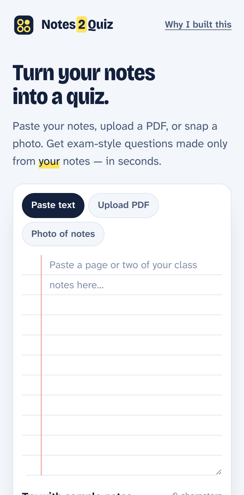
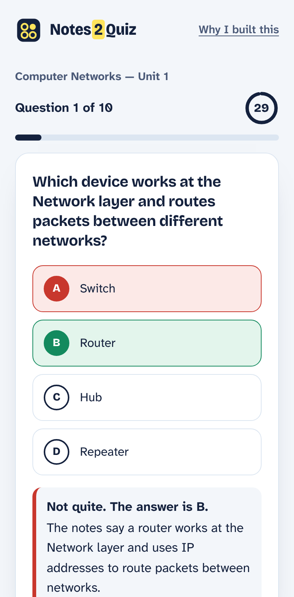
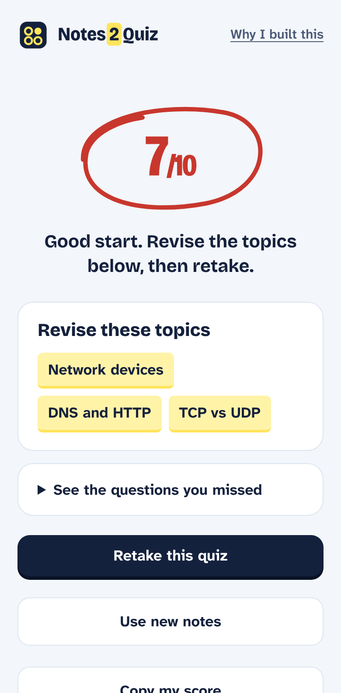

# Notes2Quiz

**Turn your own notes into an exam-style quiz — in seconds.**
Paste your notes, upload a PDF or snap a photo. Notes2Quiz writes multiple-choice questions only from what you studied, checks every answer, and tells you exactly which topics to revise.

**Live app:** [notes2quiz.vercel.app](https://notes2quiz.vercel.app)

> © 2026 **P Om Shiva** — M.Tech CSE (2nd year), Pondicherry University. **All rights reserved.**
> This code is shared so it can be seen, not copied. Copying, reusing, deploying or submitting it as your own work without my written permission is not allowed. See [LICENSE](LICENSE).

<p>
  
  
  
</p>

---

## Why I built this

Every exam season I saw the same thing. Friends read the same notes again and again, felt ready, and then went blank in the exam hall. Reading feels like studying. **Testing yourself is what makes it stick.**

Most students don't have a teacher to quiz them the night before an exam. So I built one that every student can use — free, no sign-up, made from their own notes. A student in a small-town college should be able to practise exactly like a topper in a big city.

If this helps even one student walk into the exam hall confident, it was worth building.

— **P Om Shiva**, M.Tech CSE (2nd year), Pondicherry University

## What it does

- **Three ways to add notes:** paste text, upload a PDF (text is read in the browser), or take a photo of handwritten or printed notes.
- **Questions only from your notes:** the AI is told never to use outside facts, and badly formed questions are thrown away.
- **Difficulty levels:** Easy (recall), Medium (understanding), Hard (application, comparisons, "which is NOT true").
- **5, 10 or 15 questions,** with an optional 30-second timer per question.
- **Instant feedback:** right or wrong, the correct answer, and a one-line reason.
- **"Revise these topics":** your score plus the exact sub-topics you missed, and a review of every missed question.
- **Accessible:** keyboard answers (1–4 or A–D), screen-reader labels, high-contrast colours, the Atkinson Hyperlegible typeface, reduced-motion support.

## How it works

```
Browser (HTML + CSS + JavaScript)
  ├─ reads text / PDF (pdf.js) / photo (resized in the browser)
  └─ POST /api/quiz  ──►  Vercel Function (api/quiz.js)
                             ├─ builds a strict exam-setter prompt
                             ├─ calls Gemini through Vercel AI Gateway (server side, no key in the browser)
                             ├─ checks every question: 4 unique options, one valid answer, no repeats
                             └─ shuffles options so the answer isn't always "A"
```

- **Front end:** plain HTML, CSS and JavaScript — no framework, loads fast on low-end phones.
- **Back end:** one serverless function on Vercel, with a per-visitor rate limit.
- **AI:** Google Gemini via Vercel AI Gateway, with automatic fallback to a second model if the first fails.
- **Security:** the AI key never reaches the browser; uploads are size-limited; all AI text is rendered as plain text, never HTML.

## Tech stack

HTML · CSS · JavaScript · Node.js (Vercel Functions) · Vercel AI Gateway · Google Gemini · pdf.js · Git & GitHub · Vercel

## Author

**P Om Shiva** — M.Tech Computer Science & Engineering (2nd year), Pondicherry University
GitHub: [@omshiva24](https://github.com/omshiva24) · YouTube: [TechVibe24](https://youtube.com/@techvibe24)

## License

© 2026 P Om Shiva. All rights reserved. No permission is granted to copy, modify, deploy or reuse this project without the author's written permission. Third-party fonts (SIL OFL) and pdf.js (Apache 2.0) keep their own licences. See [LICENSE](LICENSE).
